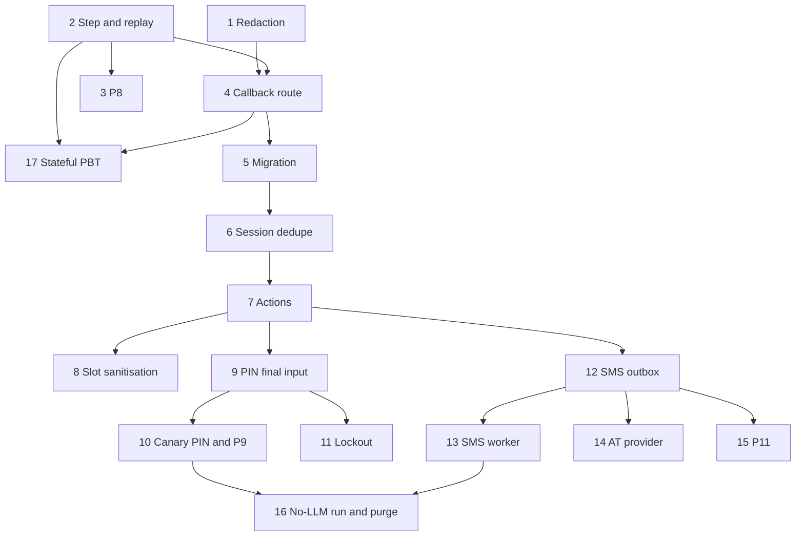

# Implementation Plan: runtime and SMS

## Overview

Runtime library for serving USSD callbacks and the SMS fallback: redaction, pure step/replay, the callback route, sessions and dedupe, upstream actions, PIN safety, lockout, and the SMS outbox and worker. No LLM in the per-screen path.

Prerequisite: `state-machine-validators` tasks 1-12. One task at a time.

## Tasks

- [x] 1. Redaction filter
  - `redact.py` logging filter dropping `text`, `pin`, `password`, `token`, `authorization`; unit tests for dict, extra fields and exception text.
  - _Requirements: 4.1_
- [x] 2. Pure machine step and replay
  - `machine.py`: `step` and `replay`; no I/O. Unit tests on the clinic bundle: `""`, `"1"`, `"1*2*3"`, `"1*0*1"`, `00`.
  - _Requirements: 2.1, 1.2_
- [x] 3. Property test P8 (replay equivalence)
  - Stateful stepping equals replay of cumulative text.
  - _Requirements: 2.1_
- [x] 4. FastAPI callback route
  - Router factory, form parsing, `CON`/`END` text/plain, wrong token 404, malformed form 200 `END`. Disable body logging for `/ussd/*`.
  - Contract tests with recorded AT payload fixtures.
  - _Requirements: 1.1, 1.3, 1.4, 1.6_
- [x] 5. Alembic migration for sessions and events
  - Tables `ussd_sessions`, `session_events`, `option_cache`, `pin_attempts` per `docs/ARCHITECTURE.md` section 6; no column may hold a PIN or input value.
  - _Requirements: 2.2, 4.1_
- [x] 6. Session cache and dedupe
  - `(session_id, step_index)` unique; duplicate returns stored response; replayed state wins on mismatch.
  - Integration test: same callback twice, one action.
  - _Requirements: 2.3, 2.4_
- [x] 7. Actions: REST upstream
  - 3 s deadline, Idempotency-Key, outcomes ok/slow/long/error; `examples/clinic_api/` mock service.
  - _Requirements: 3.1_
- [x] 8. Slot sanitisation and option cache
  - Sanitise upstream values; TTL 60 s option cache.
  - _Requirements: 3.3, 3.4_
- [x] 9. PIN as final input
  - PIN handled in memory only, passed upstream, `END` response; never stored or rendered.
  - _Requirements: 4.2_
- [x] 10. Canary PIN test and P9
  - Full clinic flow with a canary PIN; grep responses, captured logs and a DB dump. Property `test_P9_pin_canary`.
  - _Requirements: 4.1, 4.5_
- [x] 11. Lockout
  - 3 failures per MSISDN HMAC -> 15 min lock; identical message; integration test.
  - _Requirements: 4.3, 4.4_
- [x] 12. SMS outbox and provider interface
  - `SmsProvider`, `EmulatorSms`, enqueue on slow/long/202; `END` "sent by SMS".
  - _Requirements: 3.2, 5.1_
- [x] 13. SMS worker
  - `FOR UPDATE SKIP LOCKED` claim, backoff, bounded attempts, own-MSISDN-only, rate limits and daily cap.
  - _Requirements: 5.2, 5.3_
- [x] 14. AfricasTalkingSms provider and modem stub
  - Provider reading `AT_USERNAME`/`AT_API_KEY` from env only; `ModemSms` stub raising NotImplemented behind the interface.
  - _Requirements: 5.1_
- [x] 15. Property test P11 (SMS lossless and budget)
  - _Requirements: 5.4_
- [x] 16. No-LLM integration run and retention purge
  - Run the integration suite with LLM env vars unset; purge job tests for sessions and sms rows.
  - _Requirements: 1.5, 6.1_
- [ ]* 17. Stateful PBT (optional)
  - `RuleBasedStateMachine` of random key presses against a compiled bundle. Cut-list item 9: build last, only if time remains.

## Task Dependency Graph

Task numbers refer to the list above. An arrow means "needs the earlier task first".



Waves (tasks in a wave have no dependency on each other and can run together):

```json
{
  "waves": [
    { "id": 0, "tasks": ["1", "2"] },
    { "id": 1, "tasks": ["3", "4"] },
    { "id": 2, "tasks": ["5", "17"] },
    { "id": 3, "tasks": ["6"] },
    { "id": 4, "tasks": ["7"] },
    { "id": 5, "tasks": ["8", "9", "12"] },
    { "id": 6, "tasks": ["10", "11", "13", "14", "15"] },
    { "id": 7, "tasks": ["16"] }
  ]
}
```

## Notes

- Property tests carry `@pytest.mark.pbt` and are named `test_P<n>_<short_name>` (see `.kiro/steering/testing.md`).
- Task 17 is optional (cut-list item 9). Never weaken a property to make it pass; report the counterexample and fix the code.
- Requirement references point to `requirements.md` in this folder.
