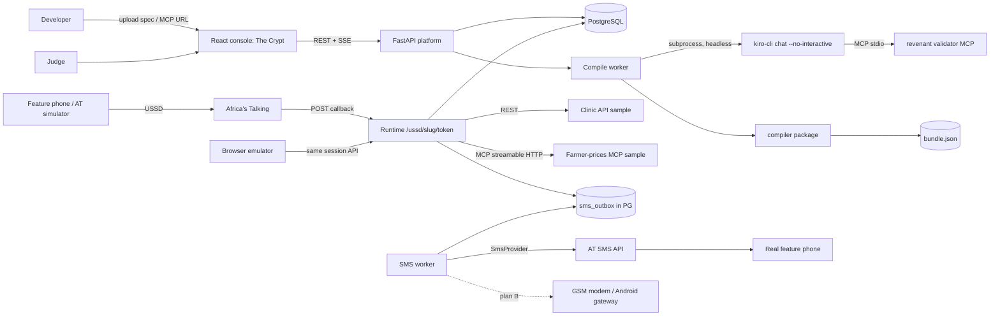
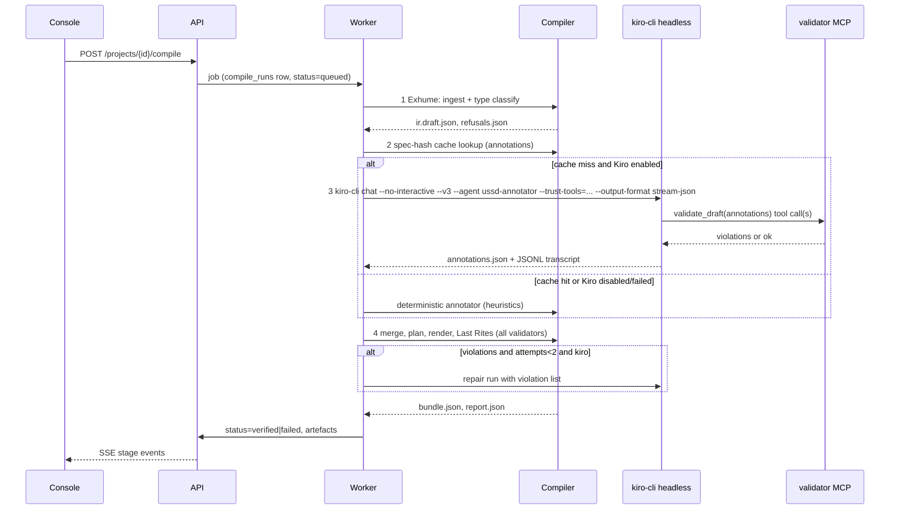
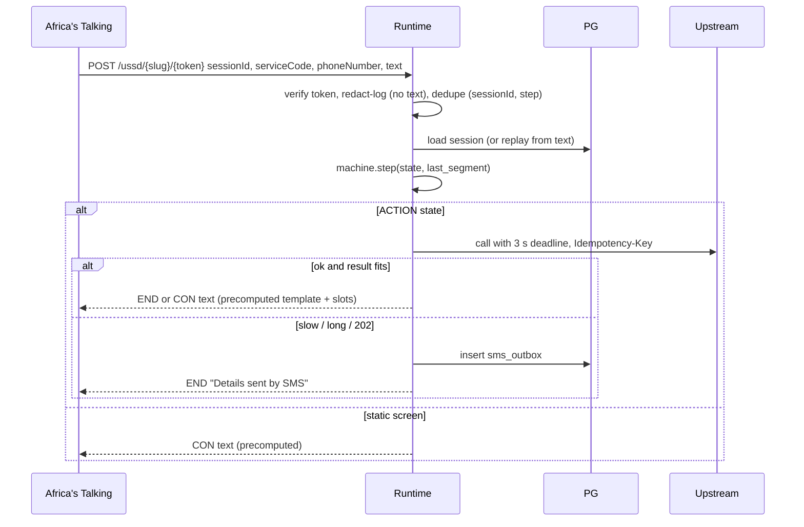
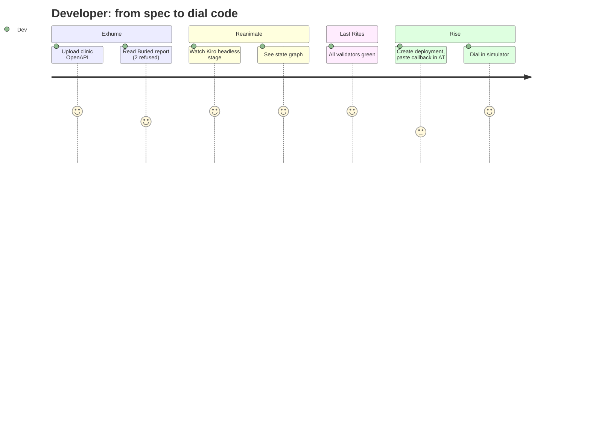
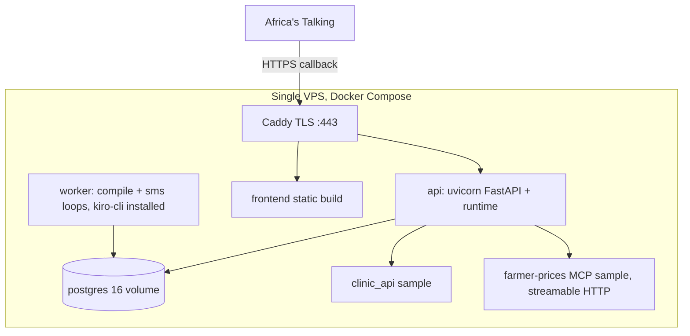

# Revenant: Architecture

Companion docs: `architecture/IR_AND_TYPE_SUBSET.md` (IR, subset, refusal codes), `architecture/DIAGRAMS.md` (extra diagrams), `docs/PLATFORM_FACTS.md`, `docs/DECISIONS.md`.

## 1. Principles
1. Compile-time intelligence, runtime determinism. LLM only at compile time (annotation) and optionally in one bounded free-text parser (off by default). The per-screen path is table lookup + string formatting.
2. The validators are the gate. Nothing the LLM writes reaches a bundle without schema validation and the full validator suite.
3. Refuse loudly. Out-of-subset input produces a typed refusal, never a degraded guess.
4. One runtime library; the platform and each generated app use the same code.
5. Fewest moving parts: FastAPI + Postgres (job queue and cache in Postgres). No Redis, no Celery.

## 2. System context


## 3. Repository layout (existing scaffold dirs reused)
```
revenant/
  .kiro/                         specs, steering, hooks, agents, settings (see architecture/KIRO_PLAN.md)
  backend/src/revenant/
    compiler/   ingest_openapi.py ingest_mcp.py ir.py subset.py refusals.py planner.py render.py gsm7.py
                validators/ (reachability, exits, back, steps, length, pin, sms) annotate/ (kiro_headless, deterministic, schema)
                emit.py cli.py
    runtime/    app.py (FastAPI router factory) machine.py session.py actions.py sms.py redact.py
    platform/   api/ (routers) models/ services/ worker.py auth.py settings.py
    mcp_validator/ server.py       (MCP server exposing validators to Kiro)
  backend/alembic/
  frontend/     React + TS + Vite
  examples/     specs/ (clinic.openapi.yaml, unsupported-demo.openapi.yaml) clinic_api/ farmer_prices_mcp/
  generated/    clinic-booking/  farmer-prices/    (committed emitter output; Skeleton Crew folders)
  infrastructure/ docker-compose.yml Dockerfile.api Dockerfile.worker Caddyfile
  tests/        unit/ pbt/ integration/ e2e/
  scripts/      probe_at.py, kiro_smoke.sh, seed.py
```
Stack picks: Python 3.12, FastAPI, SQLAlchemy 2 + Alembic, Pydantic v2, `mcp` official Python SDK (client + FastMCP for samples), `openapi-spec-validator` + own `$ref` resolver (so SSRF policy is ours), `httpx`, `rapidfuzz` (deterministic fuzzy match), Hypothesis, pytest, React 18 + TS + Vite, React Flow for the state graph, TanStack Query.

## 4. Compile workflow (Kiro headless is stage 3)

Kiro stage contract:
- Working dir: `runs/<run_id>/` containing `ir.draft.json`, `refusals.json`, `carrier-rules.md` (copy of steering), `annotations.schema.json`. The agent is told to write only `annotations.json`.
- Command (flags verified, PLATFORM_FACTS): `kiro-cli chat --no-interactive --v3 --agent ussd-annotator --trust-tools=read,write --output-format stream-json --require-mcp-startup "<instruction>"`. Exact trust-tool ids for write-limited-to-workdir to be confirmed on Day 1 (`--trust-tools` accepts `@builtin`, `@server`, globs per docs); no shell, no web.
- Spec text (descriptions, summaries) is untrusted data placed in files, never in the instruction string.
- Output is parsed only if it validates against `annotations.schema.json` (`additionalProperties:false`, label lengths, enum of keys). Else: counted as failure, deterministic annotator used, `annotator=deterministic(fallback: reason)` recorded.
- Timeout 120 s (our budget), one run per spec hash, max 2 repair attempts.
- Stored: instruction hash, exit code, JSONL transcript path, model id from stream, duration. Committed demo transcripts live in `.kiro/evidence/` (honest evidence of real runs).
- What Kiro adds that heuristics cannot: shorter human labels within budgets, grouping operations into a <=7 item root menu, selecting `options_from` links across operations, risk classification, local-language-safe copy per steering. Everything it proposes is checked, so a bad suggestion fails validation, not production.
- Honesty rule: UI and report always say which annotator ran and whether it was cached.

## 5. Runtime request path

- **Replay-from-text:** the machine is deterministic, so state can always be rebuilt from `text` split on `*`. Postgres session rows are a cache plus the place for fetched option lists. Property P8 asserts stateful == replay.
- **Dedupe:** `(session_id, step_index)` unique; a repeated callback returns the stored response without re-executing actions (retry safety; AT retry behaviour UNVERIFIED U4).
- **Deadline:** upstream timeout 3 s (design budget). Carrier-side limits per PLATFORM_FACTS (10-15 s application response on Airtel).
- **Option cache:** `option_cache(key, value, expires_at)`; TTL default 60 s (our choice). Static screens are fully precomputed; dynamic option menus render from cached list with slot budgets.
- **Transactional safety:** write operations require a CONFIRM state; money/identity-risk operations require PIN. PIN lives only in the request body of the final input step: held in memory, passed to upstream, never persisted or logged; the response is `END`. Lockout: 3 upstream auth failures per hashed MSISDN -> 15 min block (our policy).
- **Bounded free text (optional, off by default):** field annotated `interpret`: deterministic rapidfuzz match first; optional LLM call constrained to return one candidate id or `NONE`, 2 s timeout, falls back to "Not understood, pick from list". Runtime works with the flag off or no key.
- **SMS:** `SmsProvider` interface: `AfricasTalkingSms` (sandbox/live), `ModemSms` (plan B), `EmulatorSms` (writes to inbox table shown in emulator). Messages are GSM-7, split by segment budget; validator checks worst-case segments at compile time (concatenated SMS segment size is 153 septets, single 160: standard GSM, not AT-specific).

## 6. Database schema (PostgreSQL 16)
```sql
users(id uuid pk, email citext unique, pw_hash text, role text check (role in ('owner','viewer')), created_at timestamptz)
sessions_web(id uuid pk, user_id fk, token_hash bytea unique, expires_at timestamptz)
projects(id uuid pk, owner_id fk users, slug text unique, title text, is_public_sample bool, created_at timestamptz)
sources(id uuid pk, project_id fk, kind text check (kind in ('openapi','mcp')), origin text, content_sha256 bytea, raw jsonb, created_at timestamptz)
compile_runs(id uuid pk, project_id fk, source_id fk, status text, stage text, annotator text,   -- kiro-cli|deterministic|cached
             kiro_exit_code int, kiro_transcript_path text, kiro_model text, error text,
             started_at timestamptz, finished_at timestamptz)
refusals(id uuid pk, run_id fk, op_id text, path text, code text, message text)
bundles(id uuid pk, run_id fk, version int, bundle_hash bytea, ir jsonb, machine jsonb, screens jsonb,
        status text check (status in ('draft','verified','failed','deployed')), created_at timestamptz,
        unique(project_id, bundle_hash))
validation_results(id uuid pk, bundle_id fk, validator text, passed bool, violations jsonb, duration_ms int)
annotation_cache(spec_hash bytea, agent_version text, annotations jsonb, run_id fk, primary key(spec_hash, agent_version))
deployments(id uuid pk, bundle_id fk, channel_code text, at_channel_note text, callback_token_hash bytea,
            sms_provider text, status text, created_at timestamptz)
upstream_credentials(id uuid pk, project_id fk, kind text, ciphertext bytea, nonce bytea, key_id text)
ussd_sessions(session_id text pk, deployment_id fk, msisdn_enc bytea, msisdn_hmac bytea, state_id text,
              params jsonb, step_index int, last_response text, expires_at timestamptz)   -- no secrets, purged after expiry
session_events(id bigserial pk, session_id text, step_index int, state_id text, kind text, at timestamptz)  -- redacted: no input values for PIN/free text
sms_outbox(id uuid pk, deployment_id fk, msisdn_enc bytea, body text, segments int, status text, attempts int,
           next_attempt_at timestamptz, provider_ref text, created_at timestamptz)  -- worker uses FOR UPDATE SKIP LOCKED
option_cache(key text pk, value jsonb, expires_at timestamptz)
pin_attempts(msisdn_hmac bytea, deployment_id fk, failures int, locked_until timestamptz, primary key(msisdn_hmac, deployment_id))
audit_log(id bigserial pk, user_id, action text, target text, at timestamptz)
```
Notes: `msisdn_enc` AES-GCM with env key; `msisdn_hmac` for lookups/lockouts. A purge job deletes expired sessions and sent sms rows after 24 h (our retention choice). `raw` source uploads capped at 2 MB.

## 7. API specification (platform, JSON over HTTPS, prefix `/api/v1`)
| Method + path | Auth | Purpose |
|---|---|---|
| POST `/auth/register`, `/auth/login`, `/auth/logout` | none/cookie | email+password; cookie session |
| GET `/me` | cookie | current user |
| GET `/projects` / POST `/projects` | cookie | list/create (samples visible to all, read-only) |
| GET `/projects/{id}` | cookie or public sample | overview |
| POST `/projects/{id}/sources` | owner | multipart spec upload, or `{kind:'mcp', url}` (SSRF-checked) |
| POST `/projects/{id}/compile` | owner | enqueue; body `{annotator:'kiro'|'deterministic'|'auto', fresh:false}`; rate limited |
| GET `/compile-runs/{id}` | member | status + stage log |
| GET `/compile-runs/{id}/events` | member | SSE: `stage`, `log`, `kiro_event`, `validator`, `done` |
| GET `/bundles/{id}` | member | IR, machine graph, screens |
| GET `/bundles/{id}/report` | member | validators + refusals |
| GET `/bundles/{id}/download` | member | bundle.json or generated app zip |
| POST `/bundles/{id}/deployments` | owner | create deployment, returns callback URL with token (shown once) |
| GET `/deployments/{id}/sessions` | owner | redacted session events |
| PUT `/projects/{id}/credentials` | owner | upstream API key (write-only) |
| POST `/emulator/sessions` | cookie or sample | start emulator session `{deployment_or_bundle_id, msisdn}` |
| POST `/emulator/sessions/{sid}/input` | same | `{text}` returns `{type:'CON'|'END', text}` (same code path as AT callback) |
| GET `/emulator/inbox/{msisdn}` | same | simulated SMS inbox |
| GET `/healthz` | none | liveness |

Runtime (public, AT-facing): `POST /ussd/{slug}/{token}` form-encoded; returns `text/plain`. `POST /sms/at/delivery/{token}` (delivery report; optional).
Errors: RFC 7807 problem JSON. Pagination: `limit/cursor`.

## 8. Authentication and authorisation
- Console: email + password (argon2id), server-side session in `sessions_web`, `HttpOnly; Secure; SameSite=Lax` cookie, CSRF token header on state-changing calls. Roles: `owner` (own projects), `viewer` (seeded judge account; read-only samples + emulator).
- Public without login: sample projects (read-only), `/emulator`, `/judges`, `/healthz`.
- Runtime endpoint: unguessable per-deployment token in path, stored hashed; rate limit per token and per MSISDN HMAC. AT callback signing/IP list UNVERIFIED (U4); add IP allowlist if found.
- Secrets: upstream credentials AES-GCM encrypted, never returned by the API, never in bundles or generated folders (generated apps read them from env).
- Kiro: `KIRO_API_KEY` only in worker env.

## 9. Integration specs
**Africa's Talking USSD:** one sandbox channel per generated app (limit 2). Callback `https://<host>/ussd/<slug>/<token>`. Response `text/plain`, `CON `/`END ` prefix. Probe script `scripts/probe_at.py` echoes screens of length 160/182/183 and a non-GSM-7 character to settle U4/U7 on Day 1.
**Africa's Talking SMS:** `SmsProvider.send(msisdn, body)`; sandbox first; real-handset path per U5.
**OpenAPI:** accept 3.0/3.1 JSON/YAML, <=2 MB; resolve local `$ref` only by default, remote refs blocked unless allowlisted host; operations keyed by `operationId` (generated from method+path if missing, flagged).
**MCP:** official SDK client; transports: streamable HTTP (SSRF-checked) for users; stdio only from a server-side registry of bundled samples (no user-supplied commands). Calls `initialize`, `tools/list`; at runtime `tools/call`. Missing `outputSchema` -> text shape.
**Kiro:** see section 4. **Validator MCP** (`revenant mcp-validator`, stdio): tools `validate_draft`, `explain_violation`, `list_limits`.

## 10. Component hierarchy (frontend)
```
<App>
 ├ <ThemeProvider (crypt)> <ToastHost> <Router>
 ├ <AppShell> <SignalBars status/> <NavRail/> <Outlet/>
 ├ pages/
 │  Landing ─ Hero(grave-GSM) ─ HowItWorks ─ SubsetTable ─ CompareTable
 │  Login/Register
 │  Crypt (projects) ─ ProjectCard(tombstone) ─ NewProjectDialog
 │  Project ─ Tabs{Exhume, Reanimate, Last Rites, Rise}
 │     ExhumePanel ─ SourceUpload | McpUrlForm | SamplePicker ─ BuriedList(refusals)
 │     ReanimatePanel ─ StageTimeline ─ LogStream ─ KiroEventFeed ─ AnnotatorBadge
 │     StateGraph (ReactFlow) ─ ScreenInspector ─ CharCounter
 │     LastRitesPanel ─ ValidatorList ─ ViolationDetail ─ WorstCaseTable
 │     RisePanel ─ DeploymentCard ─ CallbackUrlReveal ─ ATChannelSteps ─ SmsProviderSelect ─ SessionLog
 │  Seance (emulator) ─ PhoneShell(keypad, 182x? LCD) ─ SmsInbox ─ AppPicker ─ RealDeviceBadge("simulated handset")
 │  Judges ─ ChecklistWithLinks
 │  Settings ─ CredentialsForm
 └ shared/ api client, sse hook, a11y utils
```
Page inventory (route): `/` Landing; `/login`; `/crypt`; `/crypt/:slug` (tabs); `/crypt/:slug/runs/:runId`; `/seance` (emulator, public); `/seance/:slug`; `/judges`; `/settings`; `/404`. Every page has loading, empty, error states. Emulator LCD fixed to the carrier max-char width in monospace; keyboard operable; `aria-live` on screen text.

## 11. User journeys

Journeys: (J1) Developer compile + deploy as above. (J2) End user: dial, choose clinic/day/slot, enter PIN, receive SMS. (J3) Judge: open `/seance`, pick sample, dial, trigger SMS fallback, view `/crypt/clinic-booking` read-only. (J4) Spec change: re-run `revenant verify`, see hash diff and failures.

## 12. Deployment architecture

- One public HTTPS host is required anyway for the AT callback. Hosting provider is a day-1 choice (any VPS with Docker); free-tier pricing not verified, so none assumed. Must stay up until judging ends 29 Jan 2027.
- Env: `DATABASE_URL`, `SECRET_KEY`, `DATA_KEY` (AES), `AT_USERNAME`, `AT_API_KEY`, `KIRO_API_KEY`, `PUBLIC_BASE_URL`, `ALLOWED_MCP_HOSTS`. Only `.env.example` committed.
- Generated apps (`generated/*`): each has `app.py` (FastAPI, imports vendored `revenant_runtime/`), `bundle.json`, `Dockerfile`, `.env.example`, `README.md`. Deployable alone without the compiler.
- CI (GitHub Actions): ruff, mypy, pytest (unit + pbt with fixed seed print), frontend build, secret scan, `revenant verify generated/*`.

## 13. Performance and sizing (stated as budgets, not measurements)
Callback target <3 s end to end for demo flows; static screens are dictionary lookups. Measure with the integration test and report the observed p95 only if actually measured.
